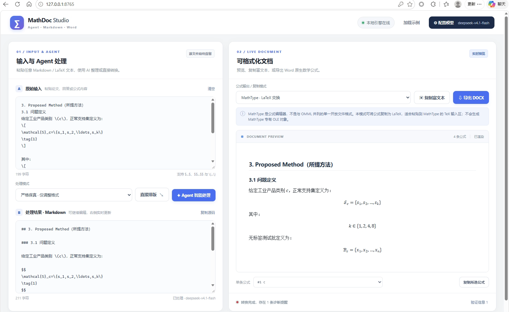

<div align="center">

# MathDoc Agent Studio

**本地优先的 Markdown / LaTeX → Word 学术排版工作台**

把 AI 输出里的公式，变成 Word 中可编辑的原生公式。


[功能](#功能) · [界面预览](#界面预览) · [快速开始](#快速开始) · [使用方法](#使用方法) · [公式模式](#公式模式对比) · [常见问题](#常见问题)

</div>

---

## 简介

MathDoc Agent Studio 是一个**可以直接运行的双栏网页应用**，不是静态设计稿。它解决一个很具体的问题：

> 大模型输出里的 Markdown / LaTeX 公式，直接粘进 Word 后经常变成乱码、图片，或者干脆消失。

本项目的做法是：文本先经 **Pandoc AST** 解析，浏览器里用 **MathML** 实时预览；导出时生成 **原生 OMML**，在 Word / WPS 中可以直接选中、编辑。整个转换链路在本机完成，不上传文档；只有点击「Agent 智能处理」时才会调用你配置的模型 API。

| 常见做法 | 遇到的问题 | MathDoc 的做法 |
|---|---|---|
| 直接复制 Markdown 到 Word | 公式变成纯文本或乱码 | 导出原生 OMML，可编辑 |
| 手动跑 Pandoc 命令 | 要记参数，没有实时预览 | 网页双栏预览 + 一键导出 |
| 逐条插入 MathType | 慢，且需要商业授权 | 本地生成 OMML，无需 MathType |

## 功能

| 能力 | 说明 |
|---|---|
| **双栏工作台** | 左侧原始输入与 Agent 结果，右侧实时文档预览 |
| **实时预览** | Markdown、表格、MathML 公式，浏览器原生渲染 |
| **原生公式导出** | DOCX 内是 OMML，Word 里可编辑，不是图片 |
| **公式数量校验** | 导出前后统计公式条数，数量不符直接拒绝输出 |
| **Agent 排版** | 严格保真 / 轻度润色两种模式，兼容 OpenAI Chat Completions |
| **多模型支持** | OpenAI、DeepSeek、LM Studio、Ollama 及自定义兼容接口 |
| **配置持久化** | 保存到本地 `config.json`，界面只显示掩码，可随时清除 |
| **完全本地** | 直接排版、预览、导出均不调用模型，不消耗额度 |
| **命令行工具** | 不打开网页也能转换和审计 DOCX |

## 界面预览

以下截图均来自**实际运行**的本机实例。

<p align="center">
  
</p>

<p align="center"><em>工作台：左侧为原始输入与 Agent 处理结果，右侧为实时 Markdown / MathML 预览与 DOCX 导出入口。</em></p>

| 首次打开（空状态） | 模型配置 |
|:---:|:---:|
|  |  |
| 预览占位、处理模式与本地引擎状态 | 配置保存到 `config.json`，可随时清除 |

## 快速开始

### 环境要求

| 依赖 | 版本 | 说明 |
|---|---|---|
| Python | 3.10+ | 运行后端与转换流程 |
| Pandoc | 3.x | Markdown AST 与 DOCX/OMML 生成 |
| 网络 | 首次启动 | 自动创建 `.venv` 并安装 Python 依赖 |

### Windows 一键启动

1. 安装 Python 3.10+，并安装 Pandoc：

   ```powershell
   winget install --id JohnMacFarlane.Pandoc -e
   ```

2. 解压后，在项目目录中 **双击 `start_windows.bat`**。

   首次运行会自动创建 `.venv` 并安装依赖，需要联网；之后启动会跳过安装。

3. 服务就绪后会自动打开默认浏览器访问 `http://127.0.0.1:8765`。没弹出时手动访问该地址即可。

   > 服务已在运行时再次双击，只会重新打开页面，不会再启动第二个服务。

4. 第一次使用建议点击「加载示例」，确认预览和导出正常，再换成自己的内容。

### 手动启动

```powershell
python -m venv .venv
.venv\Scripts\activate
python -m pip install -r requirements.txt
python -m uvicorn server:app --host 127.0.0.1 --port 8765
```

macOS / Linux 可直接运行：

```bash
./start_linux_mac.sh
```

## 使用方法

1. **粘贴内容**：把论文、AI 回答或含公式的 Markdown 贴进左侧「原始输入」。
2. **选择处理方式**：
   - 「直接排版」：原样转换，不调用模型，不消耗任何额度；
   - 「Agent 智能处理」：按「严格保真」或「轻度润色」整理 Markdown，需要先在「配置模型」里填好 API。
3. **检查右侧预览**：公式、表格和标题会实时渲染；底部的「验证信息」会列出解析警告。
4. **导出或复制**：
   - 需要可编辑公式：点「导出 DOCX」，在 Word 中打开；
   - 只需要文字和表格：点「复制富文本」；
   - 需要单条公式：在「单条公式」下拉框选中后复制。
5. **配置模型**：填入服务商、Base URL、模型 ID 和 API Key，点「保存设置」写入本地配置。

> 原输入只有在点击「Agent 智能处理」时才会发送给模型；「直接排版」「预览」「导出 DOCX」全部在本机完成。

## 公式模式对比

| 模式 | 「复制所选公式」输出 | 「复制富文本」输出 | DOCX 导出 |
|---|---|---|---|
| **OMML Word** | 带 `\(...\)` / `$$...$$` 分隔符的 LaTeX，供 Word 导入 | HTML + MathML，受 Word 版本影响 | 原生 OMML（推荐） |
| **MathType / LaTeX** | LaTeX 源文本，可粘贴到 MathType 的 LaTeX 输入流程 | 公式作为 LaTeX 文本 | 仍导出原生 OMML，**不会生成 MathType 专有对象** |
| **MathML** | MathML XML | HTML 中的 MathML | 仍导出原生 OMML |

### 为什么复制富文本到 Word，公式会丢？

- **DOCX 导出**：Pandoc 直接生成 OMML（`<m:oMath>`），这是 Word 自己的公式格式，所以能显示、能编辑。
- **复制富文本**：浏览器 Clipboard API 只能写 `text/html`、`text/plain` 等标准类型，**无法写入 Word 的私有公式剪贴板格式**。HTML 里的 `<math>` 标签，Word 的粘贴器不认识，于是公式被忽略或降级为文字。

**结论：需要保留公式时，请用「导出 DOCX」→ Word 打开 → 再复制到目标文档。** 这是目前唯一可靠的路径。

### 关于 MathType

MathType 公式在 Word 中是 **OLE 复合对象**（内部为 MTEF 私有二进制），生成它需要本机安装正版 MathType（或使用其 SDK），并通过 COM 自动化完成；Pandoc 和 python-docx 都写不出这种对象。本项目因此只输出 OMML。

已经安装 MathType 的用户，可以在 Word 中用 MathType 的 **「转换方程式 / Convert Equations」** 把 OMML 公式批量转成 MathType 对象，这是官方支持的路径。

## API 配置持久化

点击「保存设置」后，配置会写入项目根目录的 `config.json`：

```json
{
  "base_url": "https://api.deepseek.com/v1",
  "model": "deepseek-chat",
  "provider": "deepseek",
  "api_key": "sk-..."
}
```

| 操作 | 行为 |
|---|---|
| 保存 | 写入 `config.json`，下次启动自动载入 |
| 再次打开弹窗 | 回填服务商 / Base URL / 模型；Key 输入框留空并显示掩码提示 |
| 清除 | 点「清除已保存配置」，或直接删除 `config.json` |
| 手动编辑 | 修改字段后，重新打开弹窗或刷新页面即可生效 |

> ⚠️ **密钥以明文保存**。`config.json` 仅限本机使用，请勿分享或提交到版本库；建议使用单独、限额的 API Key。

### 使用 API 的注意事项

- ChatGPT 网页订阅与 OpenAI API 账户独立计费，网页订阅凭据不能当作 API Key。
- 请求经本机服务转发到你配置的 API 地址；公网模型请求要求 HTTPS。
- **不得**把服务绑定到 `0.0.0.0` 或通过公网反向代理开放：当前没有用户认证、多租户隔离、URL 白名单和速率限制。
- 本地模型示例：LM Studio `http://127.0.0.1:1234/v1`；Ollama 兼容接口通常为 `http://localhost:11434/v1`。
- 自定义兼容接口的「模型列表查询」可能不受支持，手动填写模型 ID 即可。

## 命令行工具

不打开网页也能完成转换与审计：

```powershell
python mathdoc_cli.py convert samples/demo.md -o output.docx
python mathdoc_cli.py audit output.docx
```

`convert` 同样会做公式数量校验：源文档与输出 OMML 数量不一致时终止并报错，不生成不完整文件。

项目还包含 `.agents/skills/mathdoc/SKILL.md`，向支持项目级 Skills 的本地 Agent 描述转换工具与验收步骤；命令行版本不调用任何模型 API。

## 项目结构

```text
MathDoc_Agent_Studio/
├── server.py                 # FastAPI 后端：解析、预览、DOCX 导出、API 代理、配置读写
├── launch.py                 # 启动服务并自动打开浏览器
├── start_windows.bat         # Windows 一键启动
├── start_linux_mac.sh        # macOS / Linux 启动脚本
├── requirements.txt          # Python 依赖
├── static/
│   ├── index.html            # 双栏页面结构
│   ├── styles.css            # 样式
│   └── app.js                # 预览、复制、导出、Agent、配置交互
├── templates/
│   └── reference.docx        # Pandoc Word 样式模板
├── tests/
│   └── test_app.py           # 接口、公式与配置测试
├── samples/
│   ├── demo.md               # 示例输入
│   └── example_output.docx   # 示例输出
├── docs/
│   └── images/               # 实际运行截图：工作台 / 空状态 / 配置弹窗
├── create_template.py        # 重新生成 Word 样式模板
├── mathdoc_cli.py            # 命令行转换 / 审计
├── QA_验证报告.md             # 测试范围与未验证项
├── README.md                 # 本文档
├── .agents/skills/mathdoc/   # 项目级 Agent Skill 说明
├── config.json               # 运行时生成：API 配置（含明文密钥）
└── .venv/                    # 运行时生成：Python 虚拟环境（约 64 MB）
```

### 自定义页面与 Word 样式

- 页面结构：`static/index.html`
- 布局与配色：`static/styles.css`
- 交互逻辑：`static/app.js`
- Word 样式：替换 `templates/reference.docx`，或运行 `python create_template.py` 重新生成（需要 `python-docx`）

## 技术栈

| 层 | 技术 |
|---|---|
| 前端 | 原生 HTML / CSS / JavaScript，浏览器原生 MathML |
| 后端 | Python + FastAPI + Uvicorn |
| 转换 | Pandoc（Markdown AST → HTML/MathML → DOCX/OMML） |
| 模型调用 | OpenAI Chat Completions 兼容协议（httpx） |
| 配置 | 本地 JSON 文件，原子写入 |
| 测试 | pytest |

## 安全与限制

- **文档不外传**：除「Agent 智能处理」外，预览与导出均在本机完成。
- **图片与原始嵌入被忽略**：为防止读取本地文件或意外联网，图片引用、Raw HTML/LaTeX 不会进入导出结果。
- **数量校验不等于语义校验**：导出前后只核对公式条数；数量一致不代表公式语义正确，复杂公式仍需人工审查。
- **复杂 LaTeX 有限支持**：自定义宏、`align` 环境、`\tag`、图形、交叉引用等可能需要 Pandoc Lua Filter 或后处理。
- **字体以本机为准**：默认参考样式使用宋体、微软雅黑、Times New Roman；OMML 数学字体推荐 Cambria Math。
- **不保留 Word 高级特性**：本工具面向文字、公式和简单表格，不保证保留既有 DOCX 的复杂对象结构。
- **不生成 MathType OLE 对象**：原因见上文「关于 MathType」。

## 常见问题

**Q：双击 `start_windows.bat` 窗口一闪而过？**

旧版压缩包里的 bat 使用 LF 换行 + UTF-8 中文，`cmd.exe` 会解析错位并直接退出。请使用当前目录中 CRLF 换行的版本；仍有问题时，在命令行里执行 `start_windows.bat` 查看具体报错。

**Q：浏览器没有自动打开？**

服务就绪后会自动调用默认浏览器。若未弹出，手动访问 `http://127.0.0.1:8765`，并检查系统默认浏览器关联是否正常。

**Q：提示「未发现 Pandoc」？**

```powershell
winget install --id JohnMacFarlane.Pandoc -e
```

安装后重新打开程序。无法联网的机器可在其它设备下载 Pandoc 安装包后离线安装。

**Q：`pip` 安装很慢或卡住？**

`start_windows.bat` 会先使用当前 pip 源，失败后自动改用官方 PyPI 重试。也可以手动执行：

```powershell
.venv\Scripts\python.exe -m pip install --index-url https://pypi.org/simple -r requirements.txt
```

**Q：复制富文本到 Word，公式显示不出来？**

浏览器无法写入 Word 的专有公式格式。请改用「导出 DOCX」，在 Word 中打开后再复制到目标文档。

**Q：导出时报「OMML 检查失败」？**

说明有公式没能转换成功。展开「验证信息」查看 Pandoc 警告；通常由自定义宏、复杂环境或不被支持的写法导致，简化公式后重试。

**Q：端口 8765 被占用？**

新版启动脚本会检测已运行实例并直接打开页面；若被其它程序占用，请关闭该程序，或修改 `launch.py` 中的端口和 `URL` 常量（两处保持一致）。

**Q：支持 WPS 吗？**

导出的 DOCX 是标准 OOXML，WPS 可以打开；公式渲染效果以本机 WPS/Word 版本为准，目前未做 WPS 专项测试。

## 测试

```powershell
.venv\Scripts\python.exe -m pip install pytest
.venv\Scripts\python.exe -m pytest tests -q
```

当前测试覆盖：预览与 MathML、原生 OMML 导出、XSS/图片过滤、URL 校验、输入校验、Agent 兼容协议、配置读写与掩码、保存配置回退。

## 路线图

- [ ] Windows COM 自动化：在真实 Word 中打开、保存并截图审查
- [ ] 基于 AST 的安全图片导入（限定路径、MIME 与体积）
- [ ] `align`、`\tag`、自定义 `\newcommand` 的 Lua Filter 与公式定位
- [ ] MathType 转换的官方流程指引与可选集成
- [ ] 生产级部署所需的认证、密钥轮换、访问限制与监控

## 贡献

欢迎提交 Issue 和 Pull Request。提交前请确保：

```powershell
.venv\Scripts\python.exe -m pytest tests -q
```

全部通过，并尽量保持现有代码风格与安全边界。

## 许可证

本仓库暂未附带开源许可证文件。如需公开分发或商用，请先补充 `LICENSE`；Pandoc、FastAPI 等第三方依赖遵循各自的许可证。

## 致谢

- [Pandoc](https://pandoc.org/)：Markdown AST 与 DOCX/OMML 生成
- [FastAPI](https://fastapi.tiangolo.com/) / [Uvicorn](https://www.uvicorn.org/)：本地后端
- 所有为公式排版踩过坑的人

---

<div align="center">

如果这个项目帮你省下了排版公式的时间，欢迎点一个 ⭐ Star。

</div>
